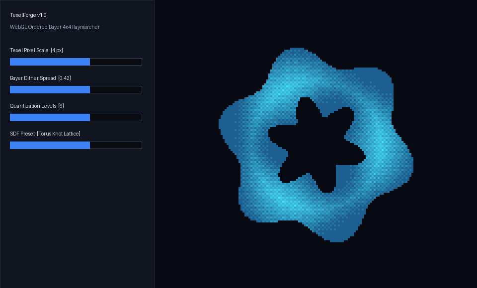

# TexelForge

A shader and texel workstation that runs in one HTML file. It raymarches signed distance fields in a WebGL 2 fragment shader, then pushes every pixel through an ordered dither and a small color palette so the result looks like low-bit hardware.



## What it does

| Area | Options |
| --- | --- |
| Geometry (5 SDF presets) | Torus knot, Menger voxel sponge, Gyroid ferrofluid, Octahedral crystal lattice, Twisted Mobius gears |
| Dither matrix | Bayer 2x2, Bayer 4x4, Bayer 8x8, Scanline halftone |
| Palette | Phosphor P1, Amber P3, Blueprint Cyan, GameBoy DMG, Monochrome Ink |
| Camera | Drag to orbit with inertia, wheel or pinch to zoom, arrow keys and plus and minus from the keyboard, double click or `0` to reset, optional auto orbit |
| Uniform inspector | Lists every active GLSL uniform, reads each value back from the GPU, and lets you edit levels, dither spread, scan period, exposure, light angle and brushed highlight live. A second tab shows the fragment shader source |
| Material maps | A third inspector tab synthesizes tileable height, normal, ambient occlusion and roughness maps for four surface patterns, with a lit preview dithered through the active palette. Press `M` to open it |
| Export | Save PNG writes the current frame, scaled up with nearest neighbor so the texels stay sharp. Save map atlas writes all four maps plus the lit preview side by side |

The shader also adds a brushed aluminum highlight (an anisotropic lobe along the surface tangent) and ambient occlusion before dithering.

## Material maps

`js/texel-maps.js` is a small procedural material generator that runs in the page and in Node. For each of four patterns (riveted plates, cobblestone, hex tiles, corroded noise) it builds a 64 by 64 texel set of maps:

- **Height.** Periodic by construction: tileable value noise and fBm, a periodic Worley field for the stones, and plate and hex lattices that repeat exactly across the map edges.
- **Normal.** A Sobel gradient with wrap-around lookups, encoded in the OpenGL convention (green points up the map). Bump strength scales the gradient.
- **Ambient occlusion.** Horizon based: for each texel and 8 directions, march out to the occlusion radius and keep the steepest rise. The map is 1 minus the mean sine of those horizon angles, so flat ground is exactly 1.
- **Roughness.** A heuristic from curvature (a wrap-around Laplacian) and occlusion: crevices read rough, ridges smooth. The panel says it is a heuristic, not a measured material.
- **Lit preview.** Lambert light from the scene's own light angle, ambient scaled by occlusion, then quantized with the same ordered dither formula, Bayer construction and palette ramp as the fragment shader. It is drawn tiled 2 by 2 so any seam would show.

The panel reports quality numbers computed from the maps themselves. For the default seed 7 at 64 by 64 texels:

| Pattern | Seam jump | Largest interior jump | Mean occlusion | Mean roughness |
| --- | --- | --- | --- | --- |
| Riveted plates | 0.005425 | 0.535391 | 0.618534 | 0.545366 |
| Cobblestone | 0.369449 | 0.402691 | 0.515169 | 0.571208 |
| Hex tiles | 0.002372 | 0.733585 | 0.767082 | 0.507617 |
| Corroded noise | 0.087676 | 0.187647 | 0.761191 | 0.509702 |

Seam jump is the largest sampled height step across the wrap edge. It is below the largest interior step for the default seed 7 shown above. Periodic coordinates and wrap-around lookups use the same sampling rules on both sides of each tile boundary, but the largest wrap step can exceed the largest interior step for other seeds. For cobblestone at seed 13 and size 64, the wrap jump is 0.402244389 and the interior maximum is 0.401748806. Normal vectors stay unit length to within about 4 in 100 million (float32 rounding).

## Run it

Open `index.html` in a current browser with WebGL 2. There is no build step and no network request. The two fonts live in `fonts/`.

To serve it instead, run `python3 -m http.server` in this folder and open the address it prints.

## Shareable state

Every control is mirrored into the URL hash, so a link restores the same view. Keys are `g` geometry, `d` dither, `p` palette, `x` texel size, `s` spread, `l` levels, `e` exposure, `a` light angle, `b` brush, `sp` scan period, `yaw`, `pit`, `z` for camera distance, `o=1` for auto orbit, and `t` for a frozen animation time in seconds. For example, `index.html#g=3&d=2&p=1&t=4` opens the lattice with 8x8 Bayer in Amber P3, paused at 4 seconds.

Maps settings use `mp` for material pattern (0 to 3 in the table's order), `ms` for seed, `mb` for bump strength (1 to 12), and `mr` for occlusion radius (2 to 12 texels). A link without these keys uses pattern 0, seed 7, strength 4 and radius 6. For example, adding `&mp=2&ms=17&mb=8&mr=9` restores hex tiles with seed 17, bump strength 8 and a 9 texel occlusion radius. Changing any Maps control updates these keys along with the scene and camera state.

## How the dither works

The scene is shaded to a single brightness value. A threshold from the chosen matrix, scaled by `u_spread` and one quantizer step, is added to it. The sum snaps to `u_levels` steps and each step picks a color from the palette ramp. The Bayer matrices are built in the shader by interleaving the bits of `x xor y` and `y`, so one function covers 2x2, 4x4 and 8x8. Scanline halftone uses a triangle wave down the rows, with `u_scanPeriod` rows per line.

Texel size is the number of CSS pixels per rendered texel. The canvas is rendered at that lower resolution and scaled up with nearest neighbor, which is also why a larger texel size runs faster.

## Tests

```
npm test
```

Node 18 or newer, nothing to install. 50 tests in four files:

- `tests/texel-maps.test.js` (22): determinism per seed, the analytic slope of a ramp recovered by the Sobel filter, unit normals, the OpenGL green convention on a bump, wrap-around normals matching normals computed inside a 2 by 2 tiled field, independent horizontal and vertical edge classification, exact seed-7 seam figures against an independent scan, the default seed-7 seam inequality and seed-13 cobblestone counterexample, occlusion ordering (a pit is darker than its rim, a wider radius never brightens), curvature signs, normal encoding round trips, Bayer tables against the classic 2 by 2 and 4 by 4 matrices, mean-preserving ordered dither, the palette ramp and shading.
- `tests/maps-ui.test.js` (14): the inline application script parses, the module loads first, all three inspector tabs are wired, the maps controls and canvases are labeled, full Maps hash restoration and normalization, integer scene and Maps control rounding, continuous uniform values, settled camera hashes, six-decimal seam readouts, documentation figures recomputed from synthesis, the `M` shortcut, the atlas export and the page design rules.
- `tests/dom-smoke.test.js` (10): document structure, metadata, accessibility hooks and repository hygiene.
- `tests/repository-hygiene.test.js` (4): encoded and binary probes, guards across all text files and binary metadata and a check for temporary files or caches.

## Checks run on this version

On the earlier version, before the Maps tab (not rerun since): loaded in headless Chrome over the DevTools protocol, all 100 combinations of geometry, dither and palette were rendered. Each frame used only colors from its palette ramp, and no two geometries or dither modes produced the same image. The layout was measured for horizontal overflow at 1440, 1024, 768, 414, 375 and 320 pixels wide.

On this version: the material maps tab was loaded in headless Chrome with software WebGL at 1440, 768 and 390 pixels wide, with no horizontal overflow and a lit preview that used only the five colors of the active palette.

## Fonts

Barlow and JetBrains Mono, both under the SIL Open Font License 1.1. The license text is in `fonts/OFL.txt`.
