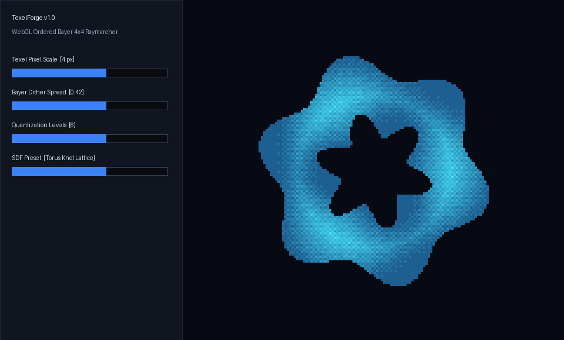

# TexelForge

A shader and texel workstation that runs in one HTML file. It raymarches signed distance fields in a WebGL 2 fragment shader, then pushes every pixel through an ordered dither and a small color palette so the result looks like low-bit hardware.

## What it does

| Area | Options |
| --- | --- |
| Geometry (5 SDF presets) | Torus knot, Menger voxel sponge, Gyroid ferrofluid, Octahedral crystal lattice, Twisted Mobius gears |
| Dither matrix | Bayer 2x2, Bayer 4x4, Bayer 8x8, Scanline halftone |
| Palette | Phosphor P1, Amber P3, Blueprint Cyan, GameBoy DMG, Monochrome Ink |
| Camera | Drag to orbit with inertia, wheel or pinch to zoom, arrow keys and plus and minus from the keyboard, double click or `0` to reset, optional auto orbit |
| Uniform inspector | Lists every active GLSL uniform, reads each value back from the GPU, and lets you edit levels, dither spread, scan period, exposure, light angle and brushed highlight live. A second tab shows the fragment shader source |
| Export | Save PNG writes the current frame, scaled up with nearest neighbor so the texels stay sharp |

The shader also adds a brushed aluminum highlight (an anisotropic lobe along the surface tangent) and ambient occlusion before dithering.

## Run it

Open `index.html` in a current browser with WebGL 2. There is no build step and no network request. The two fonts live in `fonts/`.

To serve it instead, run `python3 -m http.server` in this folder and open the address it prints.

## Shareable state

Every control is mirrored into the URL hash, so a link restores the same view. Keys are `g` geometry, `d` dither, `p` palette, `x` texel size, `s` spread, `l` levels, `e` exposure, `a` light angle, `b` brush, `sp` scan period, `yaw`, `pit`, `z` for camera distance, `o=1` for auto orbit, and `t` for a frozen animation time in seconds. For example, `index.html#g=3&d=2&p=1&t=4` opens the lattice with 8x8 Bayer in Amber P3, paused at 4 seconds.

## How the dither works

The scene is shaded to a single brightness value. A threshold from the chosen matrix, scaled by `u_spread` and one quantizer step, is added to it. The sum snaps to `u_levels` steps and each step picks a color from the palette ramp. The Bayer matrices are built in the shader by interleaving the bits of `x xor y` and `y`, so one function covers 2x2, 4x4 and 8x8. Scanline halftone uses a triangle wave down the rows, with `u_scanPeriod` rows per line.

Texel size is the number of CSS pixels per rendered texel. The canvas is rendered at that lower resolution and scaled up with nearest neighbor, which is also why a larger texel size runs faster.

## Checks run on this version

Loaded in headless Chrome over the DevTools protocol, all 100 combinations of geometry, dither and palette were rendered. Each frame used only colors from its palette ramp, and no two geometries or dither modes produced the same image. The layout was measured for horizontal overflow at 1440, 1024, 768, 414, 375 and 320 pixels wide.

## Fonts

Barlow and JetBrains Mono, both under the SIL Open Font License 1.1. The license text is in `fonts/OFL.txt`.
